# MediStock

A pharmacy inventory, procurement, and billing system with role-based access.


[](LICENSE)

[](https://github.com/boovanvaraprasad-oss)

## Table of contents

- [Overview](#overview)
- [Demo](#demo)
- [Screenshots](#screenshots)
- [Features](#features)
- [System architecture](#system-architecture)
- [Workflows](#workflows)
- [Project structure](#project-structure)
- [Tech stack and requirements](#tech-stack-and-requirements)
- [Installation and setup](#installation-and-setup)
- [Running and usage](#running-and-usage)
- [API overview](#api-overview)
- [Security notes](#security-notes)
- [Testing](#testing)
- [Roadmap](#roadmap)
- [Contributing](#contributing)
- [License](#license)
- [Author and contact](#author-and-contact)

## Overview

MediStock is a pharmacy inventory and billing application. It brings stock management, purchasing, billing, staff access, and reporting into one browser-based system.

It is intended for pharmacy owners and staff working in pharmacy operations, purchasing, inventory, billing, and compliance.

Highlights:

- Manage medicines with barcode & SKU identification, categories, manufacturers, suppliers, and units.
- Fast POS billing with instant hardware barcode scanning, live quantity steppers, and cash tender calculation.
- Automated purchase order generation for low-stock items grouped by supplier.
- Create purchase orders and receive goods into dated stock batches.
- Create bills, manage cart items, record payment, and produce clean printable tax invoices.
- Track stock by batch and deduct eligible stock using FEFO (First-Expiry-First-Out) ordering.
- Record stock returns and adjustments, with stock transaction history.
- Use role-based permissions for six staff roles.
- Review dashboards, notifications, reports (Excel & PDF), settings, and compliance audit records.

## Demo

[](#demo)

> *Demo video walkthrough coming soon. Explore the full UI screenshots and feature breakdown below.*

## Screenshots

Visual walkthrough of MediStock's core interfaces, role-specific dashboards, POS billing workstation, and batch tracking:

| Screen | File | Caption |
|---|---|---|
| Landing page | [`docs/images/landing-page.png`](docs/images/landing-page.png) | Public landing page with features, pricing, and contact inquiry form |
| Login | [`docs/images/login.png`](docs/images/login.png) | Secure JWT sign-in with lockout protection |
| Owner dashboard | [`docs/images/owner-dashboard.png`](docs/images/owner-dashboard.png) | Complete pharmacy health, revenue KPIs, sales trends, and alerts |
| Pharmacist dashboard | [`docs/images/pharmacist-dashboard.png`](docs/images/pharmacist-dashboard.png) | Active POS billing counter, dispensing queue, and shift metrics |
| Store manager dashboard | [`docs/images/store-manager-dashboard.png`](docs/images/store-manager-dashboard.png) | Operations overview, staff activity, and store settings |
| Inventory executive dashboard | [`docs/images/inventory-executive-dashboard.png`](docs/images/inventory-executive-dashboard.png) | Stock levels, FEFO batch tracking, and low-stock indicators |
| Purchase executive dashboard | [`docs/images/purchase-executive-dashboard.png`](docs/images/purchase-executive-dashboard.png) | Supplier management, PO workflows, and automated reorder generator |
| Compliance officer dashboard | [`docs/images/compliance-officer-dashboard.png`](docs/images/compliance-officer-dashboard.png) | Activity logs, schedule H/H1 registers, and regulatory audit records |
| Billing & POS workstation | [`docs/images/billing-pos.png`](docs/images/billing-pos.png) | High-speed POS register with hardware barcode scanning, live quantity steppers, and cash tender calculation |
| Printable Tax Invoice | [`docs/images/invoice.png`](docs/images/invoice.png) | Completed tax invoice with itemized tax breakdown, customer details, and `@media print` styling |
| Medicine inventory | [`docs/images/inventory.png`](docs/images/inventory.png) | Medicine master catalog with barcode/SKU search, category, and pricing filters |
| Stock batches | [`docs/images/stock-batches.png`](docs/images/stock-batches.png) | FEFO batch tracking with real-time expiry alerts and supplier traceability |
| Reports & analytics | [`docs/images/reports.png`](docs/images/reports.png) | Sales, inventory valuation, and GST reporting with Excel & PDF exports |

<details>
<summary><b>🖼️ Click to expand visual UI previews</b></summary>

### Point of Sale & Tax Invoicing
| Active POS Billing Register | Completed Printable Tax Invoice |
|:---:|:---:|
| 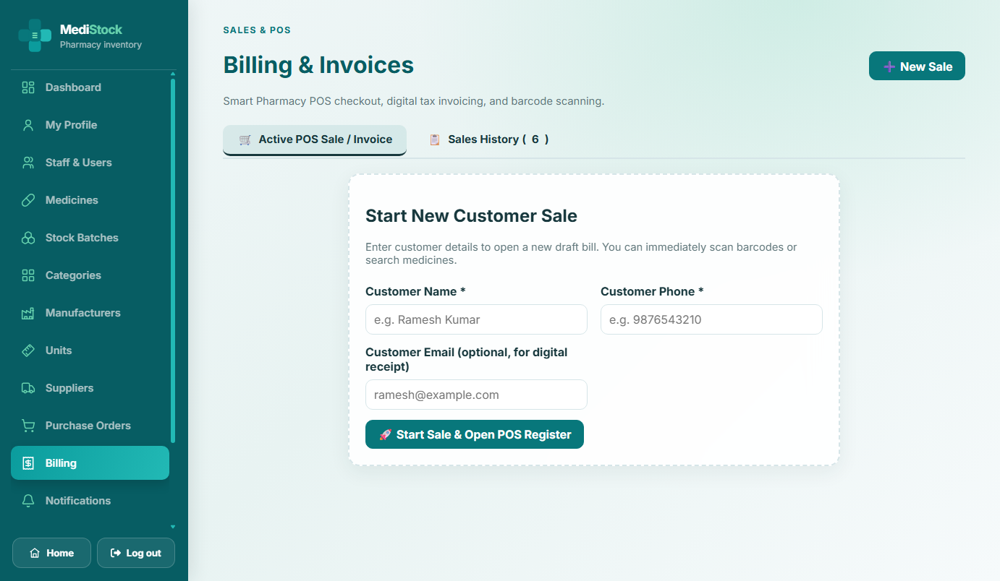 | 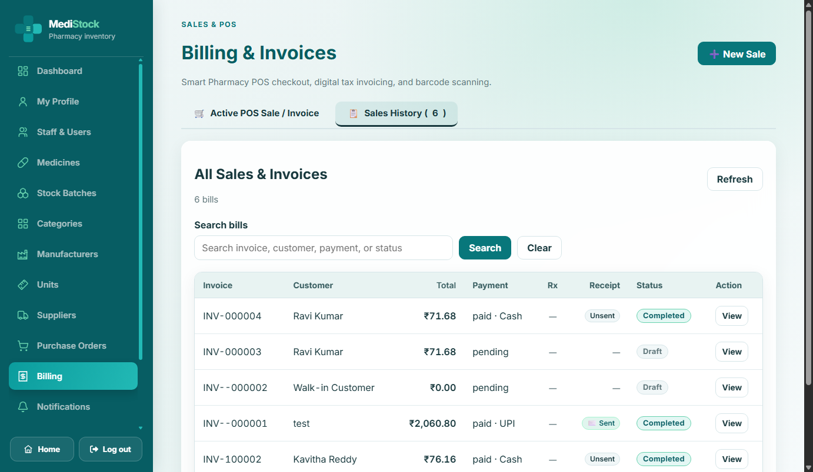 |

### Role-Based Operations Dashboards
| Owner Executive Dashboard | Pharmacist Dispensing Workspace |
|:---:|:---:|
| 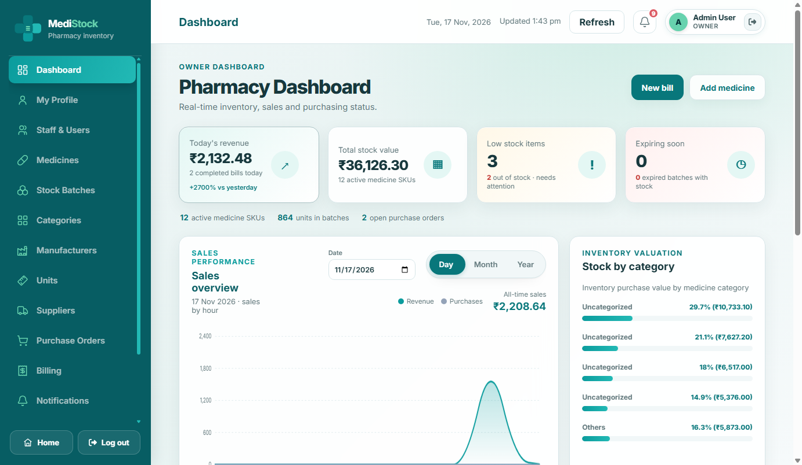 | 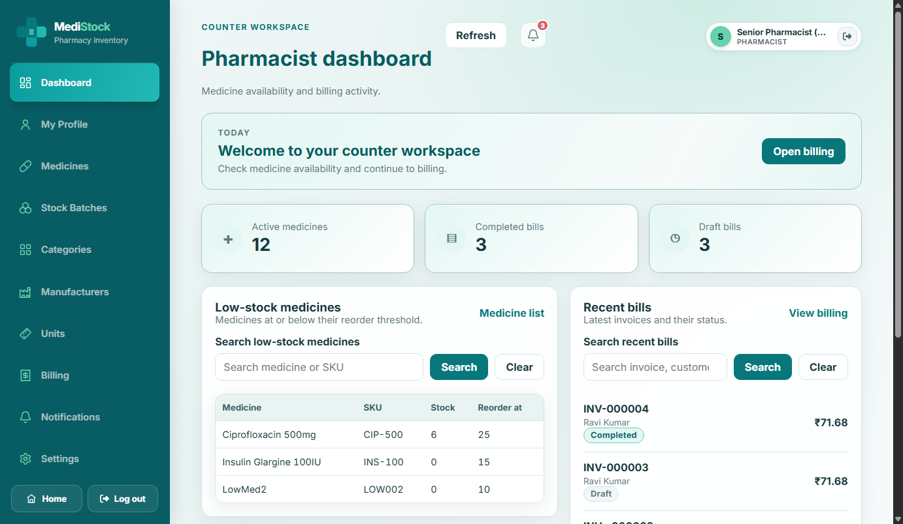 |

| Store Manager Operations | Compliance & Regulatory Dashboard |
|:---:|:---:|
| 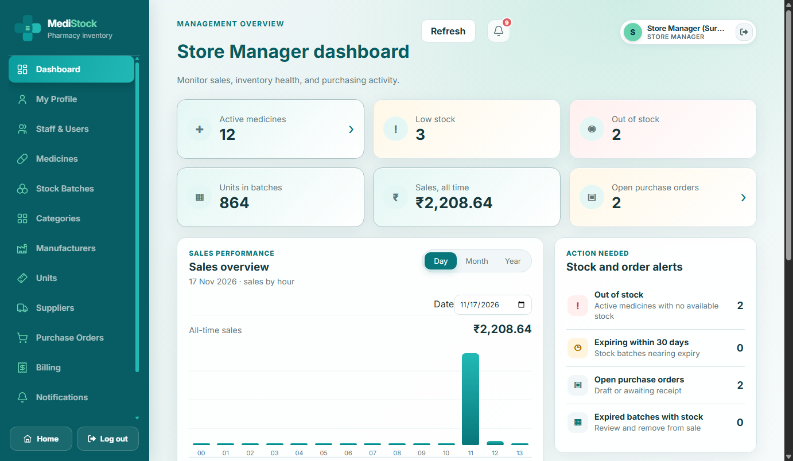 | 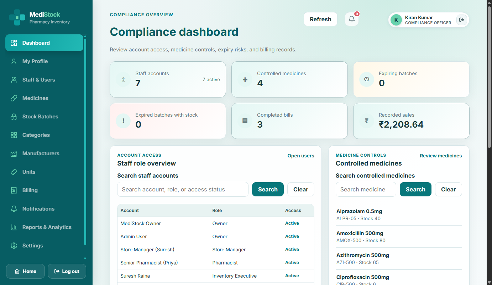 |

| Inventory Executive Workspace | Purchase Executive Workspace |
|:---:|:---:|
| 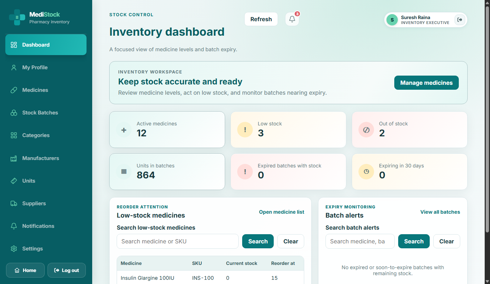 | 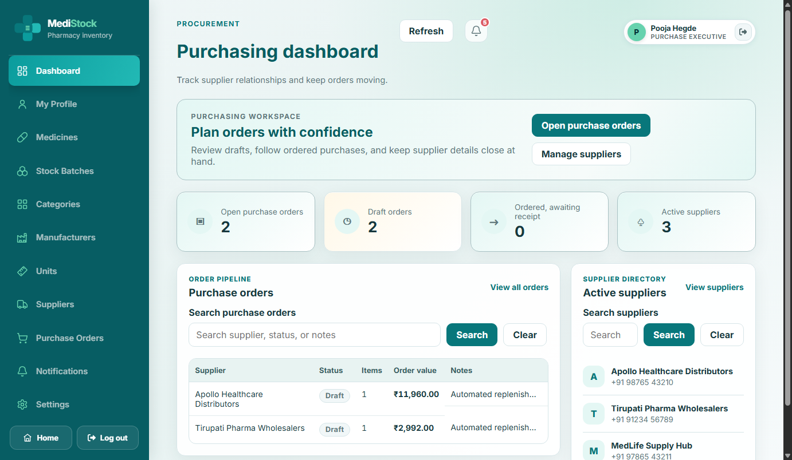 |

### Master Catalog, Batches & Analytics
| Medicine Master Inventory | FEFO Stock Batches & Expiry |
|:---:|:---:|
| 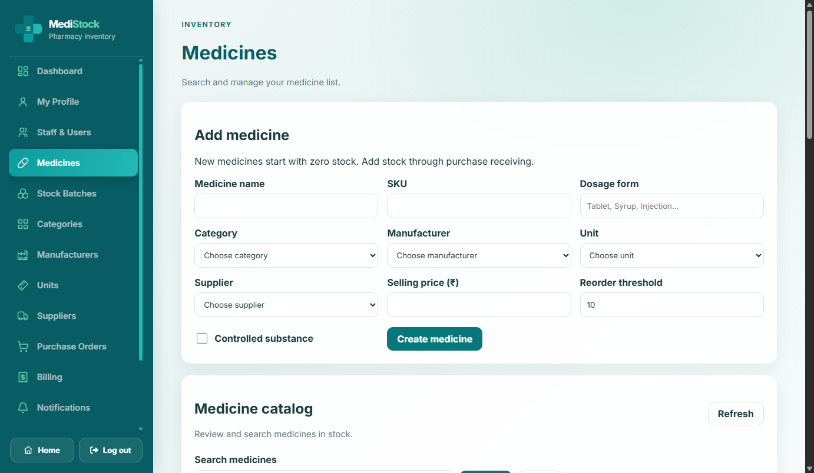 | 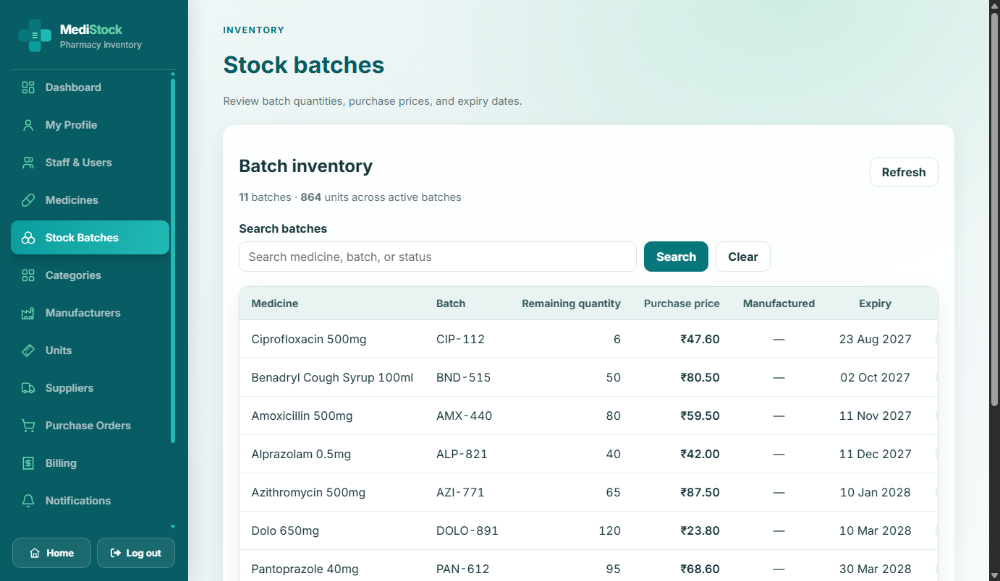 |

| Reports & Export Center | Public Landing Page |
|:---:|:---:|
| 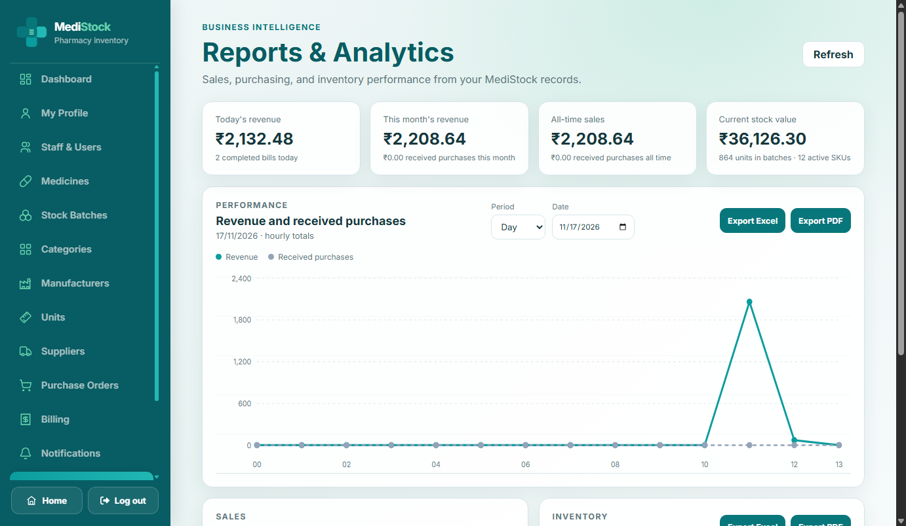 |  |

| Secure Authentication Portal | |
|:---:|:---:|
| 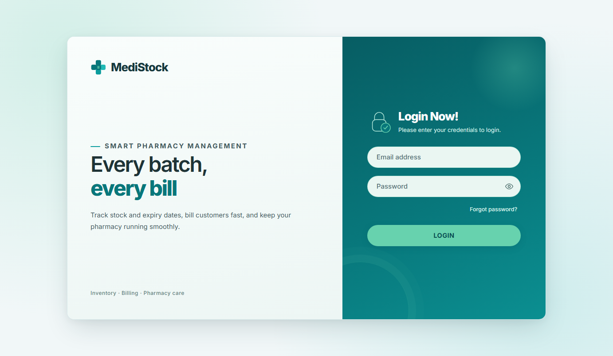 | |

</details>

## Features

### Login and account security

- JWT access and refresh tokens.
- First-account signup creates the owner account; public signup closes after that.
- Account registration validates the `@medistock.com` email domain.
- Failed login attempts are tracked, with a temporary lockout after repeated failures.
- Staff can update profile details and change their password.

### Staff and roles

- Owners can create and manage staff accounts.
- Routes enforce role permissions on the server.
- Login history is available to roles with the `login_log:read` permission.

### Master data

- Create and update categories, manufacturers, units, suppliers, and medicines.
- Medicine records support both EAN-13 barcodes and alphanumeric SKUs with dedicated lookup API for hardware barcode scanners.
- Medicine records refer to their category, manufacturer, supplier, and unit.
- Owner-only deletion checks protect master data that is still referenced.

### Procurement and stock

- Create purchase orders and their items.
- Automated PO Generator: One-click low-stock scan groups depleted medicines by supplier and computes suggested reorder quantities (`reorder_level * 2 - current_stock`).
- Receive eligible purchase orders into stock batches.
- Track batch number, quantity, purchase price, and expiry date.
- Review stock transactions, low-stock medicines, and expiring batches.
- Record batch stock adjustments with a reason.

### Billing & Point of Sale (POS)

- Redesigned unified POS register with instant barcode / SKU scanner input (`Enter` auto-adds to bill).
- Interactive quantity steppers (`+` / `-`) with real-time stock ceiling validation.
- Live tax calculation and quick cash tender chips (`₹100`, `₹200`, `₹500`, `Exact`) with dynamic change-due calculator.
- Clean printable Tax Invoice receipts with store DL number, GSTIN, and batch breakdown via `@media print`.
- Create draft bills and add, update, or remove cart items.
- Complete a bill with supported payment methods (`Cash`, `UPI`, `Card`).
- Attach doctor prescriptions for controlled medicines.
- Send digital receipts when receipt email is configured.
- Return eligible quantities to the original stock batch.

### Public Inquiries & Communications

- Public landing page contact form with sub-second response times.
- Background email dispatching via FastAPI `BackgroundTasks` for customer acknowledgments and staff alerts.

### Dashboards, audit, reports, and settings

- Role-specific dashboard pages and a shared dashboard summary API.
- Notifications for low stock, expiring batches, purchase orders, and inquiries.
- Audit events for staff, billing, stock, and purchasing actions.
- Sales and inventory reports can be exported as Excel (`.xlsx`) or PDF (`.pdf`).
- Configure store name, drug license number, GSTIN, default tax rate, and invoice prefix.

## System architecture

The browser frontend is made of static HTML, CSS, and JavaScript files served by FastAPI. Frontend requests call the versioned FastAPI routes. Route dependencies check JWTs and permissions before calling service functions. Services use Motor to access MongoDB.

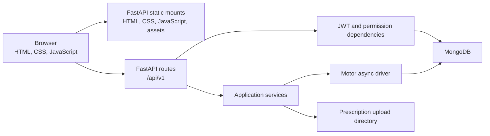

### Main MongoDB collections

| Collection | Purpose |
|---|---|
| `users` | Owner and staff accounts, roles, profile, and login-lockout fields |
| `login_attempts` | Sign-in attempt history |
| `revoked_tokens` | Revoked access and refresh token identifiers and expiry |
| `audit_logs` | Recorded audit events |
| `notification_reads` | Per-user notification read state |
| `categories` | Medicine categories |
| `manufacturers` | Medicine manufacturers |
| `units` | Units used for medicine records |
| `suppliers` | Supplier records |
| `medicines` | Medicine catalog and stock totals |
| `stock_batches` | Batch quantities, purchase prices, and expiry dates |
| `stock_transactions` | Stock movement history |
| `purchase_orders` | Purchase order headers and status |
| `purchase_items` | Purchase order item and received-batch details |
| `bills` | Bill headers, payment, invoice, and batch allocation data |
| `bill_items` | Medicines and quantities on bills |
| `bill_returns` | Bill return records |
| `settings` | Billing and pharmacy store settings |
| `counters` | Invoice number sequencing |
| `inquiries` | Website inquiries and their status |

Prescription files are stored under `backend/uploads/prescriptions/`; they are not stored as MongoDB documents.

## Workflows

### Login and role-based access

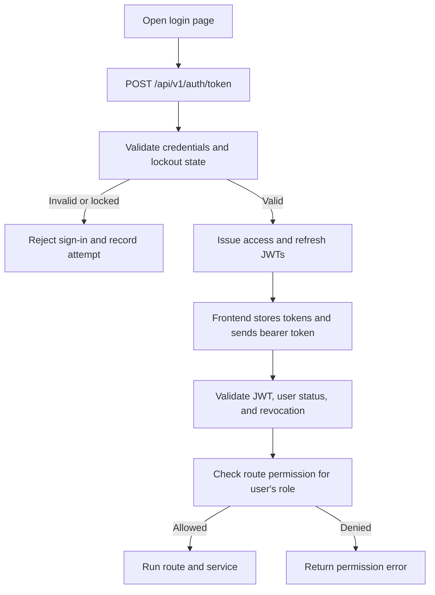

1. The login route checks the email domain, user credentials, and lockout state.
2. A successful login receives access and refresh tokens.
3. Protected routes validate the access token, confirm the user is active, and check the requested permission.

### Procurement: purchase order to stock

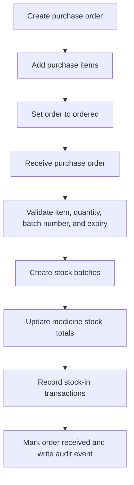

1. Create a purchase order and add its items.
2. Receiving validates the items and required batch information.
3. The receiving service creates batches, updates medicine totals, records stock-in transactions, and marks the order received within a database transaction.

### Billing: search to payment and stock deduction

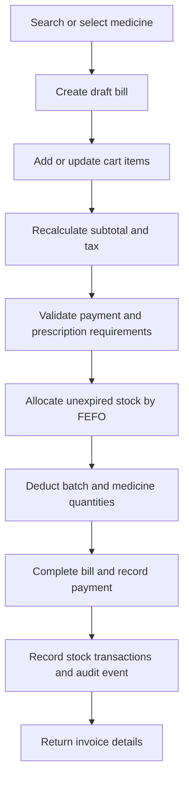

1. Create a draft bill and add medicine items.
2. The bill service recalculates totals and applies the configured tax percentage.
3. On completion, the service validates payment and any prescription requirement, deducts unexpired stock in FEFO order, and records the completed bill.

### Returns and stock adjustments

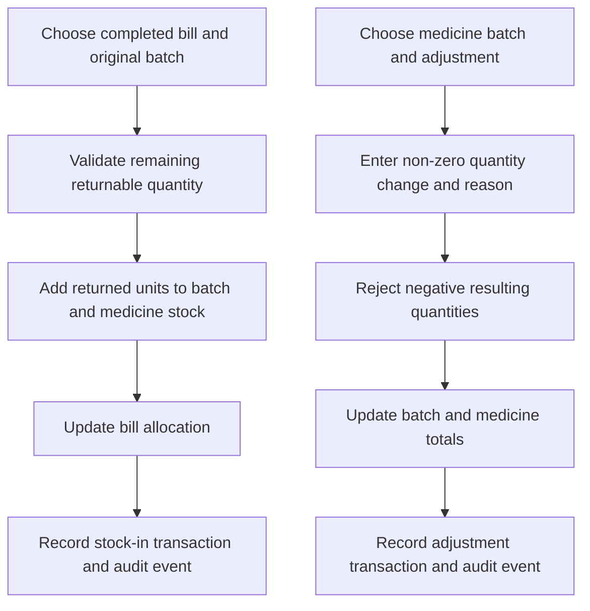

1. Returns are limited to quantities previously sold from the selected batch and not already returned.
2. Adjustments apply a non-zero positive or negative quantity change to a batch and its medicine total.
3. Both workflows record stock transactions and audit events.

## Project structure

This tree is based on the current workspace. Virtual environments, caches, `.git`, and `node_modules` are omitted.

```text
.
├── .gitignore                         # Git ignore rules
├── LICENSE                            # MIT License
├── README.md                          # Project documentation
├── pytest.ini                         # Pytest configuration
├── backend/
│   ├── .env.example                   # Example application environment
│   ├── create_test_user.py            # Local test-user helper; inspect before use
│   ├── main.py                        # FastAPI app and static file mounts
│   ├── requirements.txt               # Pinned Python packages
│   ├── uploads/
│   │   └── prescriptions/
│   │       └── .gitkeep               # Keeps the upload directory in Git
│   └── app/
│       ├── core/
│       │   ├── config.py              # Environment and SMTP configuration
│       │   ├── database.py            # MongoDB client and database proxy
│       │   ├── dependencies.py        # Authentication and permission checks
│       │   ├── email_rules.py         # Application email-domain validation
│       │   ├── indexes.py             # MongoDB index creation
│       │   ├── password_rules.py      # Password validation rules
│       │   ├── permissions.py         # Roles and role-to-permission mapping
│       │   └── security.py            # Password hashing and JWT helpers
│       ├── routes/
│       │   ├── api.py                 # Registers versioned API routers
│       │   └── v1/
│       │       ├── audit_logs.py      # Audit log API
│       │       ├── auth.py            # Authentication and profile API
│       │       ├── bills.py           # Billing and invoice API
│       │       ├── categories.py      # Category API
│       │       ├── dashboard.py       # Dashboard summary API
│       │       ├── health.py          # Health and readiness checks
│       │       ├── inquiries.py       # Inquiry and SMTP API
│       │       ├── manufacturers.py   # Manufacturer API
│       │       ├── medicines.py       # Medicine API
│       │       ├── notifications.py   # Notification API
│       │       ├── purchase_items.py  # Purchase item API
│       │       ├── purchase_orders.py # Purchase order API
│       │       ├── reports.py         # Excel and PDF report exports
│       │       ├── settings.py        # Billing and store settings API
│       │       ├── stock.py           # Stock actions and history API
│       │       ├── stock_batches.py   # Batch and expiry API
│       │       ├── suppliers.py       # Supplier API
│       │       ├── units.py           # Unit API
│       │       └── users.py           # Staff API
│       ├── schemas/                   # Pydantic request and response models
│       │   ├── auth.py
│       │   ├── bill.py
│       │   ├── bill_details.py
│       │   ├── bill_item.py
│       │   ├── bill_return.py
│       │   ├── category.py
│       │   ├── inquiry.py
│       │   ├── manufacturer.py
│       │   ├── medicine.py
│       │   ├── purchase_items.py
│       │   ├── purchase_order.py
│       │   ├── staff.py
│       │   ├── stock.py
│       │   ├── stock_batch.py
│       │   ├── supplier.py
│       │   └── unit.py
│       └── services/                  # Business logic and database operations
│           ├── audit_log.py
│           ├── auth.py
│           ├── bill_items.py
│           ├── bill_returns.py
│           ├── bills.py
│           ├── categories.py
│           ├── dashboard.py
│           ├── low_stock.py
│           ├── mailer.py
│           ├── manufacturers.py
│           ├── master_data_deletion.py
│           ├── medicines.py
│           ├── name_utils.py
│           ├── notifications.py
│           ├── purchase_items.py
│           ├── purchase_orders.py
│           ├── stock.py
│           ├── stock_adjustments.py
│           ├── stock_batch_intake.py
│           ├── stock_batches.py
│           ├── stock_transactions.py
│           ├── suppliers.py
│           ├── units.py
│           └── users.py
├── frontend/
│   ├── assets/
│   │   ├── medistock-mark.svg
│   │   ├── pharmacy-counter-bg.jpg
│   │   └── pharmacy-shelves-bg.jpg
│   ├── css/                           # Page and shared styles
│   │   ├── app-shell.css
│   │   ├── app-theme.css
│   │   ├── audit_trail.css
│   │   ├── batches.css
│   │   ├── billing.css
│   │   ├── categories.css
│   │   ├── compliance_dashboard.css
│   │   ├── confirm-dialog.css
│   │   ├── dashboard.css
│   │   ├── home.css
│   │   ├── inventory_dashboard.css
│   │   ├── landing.css
│   │   ├── login.css
│   │   ├── login_history.css
│   │   ├── medicines.css
│   │   ├── notifications.css
│   │   ├── pharmacist_dashboard.css
│   │   ├── profile.css
│   │   ├── purchase_dashboard.css
│   │   ├── purchase_orders.css
│   │   ├── record-search.css
│   │   ├── reports.css
│   │   ├── settings.css
│   │   ├── store_manager_dashboard.css
│   │   ├── suppliers.css
│   │   ├── units.css
│   │   └── users.css
│   ├── html/                          # Login, landing, dashboards, and app pages
│   │   ├── audit_trail.html
│   │   ├── batches.html
│   │   ├── billing.html
│   │   ├── categories.html
│   │   ├── compliance_dashboard.html
│   │   ├── dashboard.html
│   │   ├── home.html
│   │   ├── index.html
│   │   ├── inventory_dashboard.html
│   │   ├── login.html
│   │   ├── login_history.html
│   │   ├── manufacturers.html
│   │   ├── medicines.html
│   │   ├── notifications.html
│   │   ├── pharmacist_dashboard.html
│   │   ├── profile.html
│   │   ├── purchase_dashboard.html
│   │   ├── purchase_orders.html
│   │   ├── reports.html
│   │   ├── settings.html
│   │   ├── signup.html
│   │   ├── store_manager_dashboard.html
│   │   ├── suppliers.html
│   │   ├── units.html
│   │   └── users.html
│   └── js/                            # Frontend behavior and API client
│       ├── api/client.js
│       ├── components/
│       │   ├── app-shell.js
│       │   ├── confirm-dialog.js
│       │   ├── record-search.js
│       │   └── theme-bootstrap.js
│       ├── audit_trail.js
│       ├── batches.js
│       ├── billing.js
│       ├── categories.js
│       ├── compliance_dashboard.js
│       ├── dashboard.js
│       ├── home.js
│       ├── inventory_dashboard.js
│       ├── login.js
│       ├── login_history.js
│       ├── medicines.js
│       ├── manufacturers.js
│       ├── notifications.js
│       ├── pharmacist_dashboard.js
│       ├── profile.js
│       ├── purchase_dashboard.js
│       ├── purchase_orders.js
│       ├── reports.js
│       ├── settings.js
│       ├── signup.js
│       ├── store_manager_dashboard.js
│       ├── suppliers.js
│       ├── units.js
│       └── users.js
├── tests/
│   ├── conftest.py                   # Shared test database and API fixtures
│   ├── test_auth.py
│   ├── test_billing_and_inventory.py
│   ├── test_dashboards_and_audit.py
│   ├── test_master_data.py
│   ├── test_owner_only_master_data_deletion.py
│   ├── test_procurement_and_stock.py
│   ├── test_reports_and_settings.py
│   └── test_staff_and_roles.py
└── docs/images/                      # Application screenshots and demo media
```

## Tech stack and requirements

| Component | Version or detail |
|---|---|
| Python | `3.11+` (tested and verified on Python `3.12.10`) |
| FastAPI | `0.141.1` |
| Uvicorn | `0.52.4` |
| MongoDB | `6.0+` / `7.0+` / `8.0+` or MongoDB Atlas (Replica Set required for multi-document ACID transactions) |
| Motor | `3.7.1` |
| Frontend | Plain HTML5, CSS3, and JavaScript (Vanilla ES6+ served by FastAPI) |

The exact Python packages in `backend/requirements.txt` are:

| Package | Version |
|---|---:|
| `fastapi` | `0.141.1` |
| `uvicorn` | `0.52.4` |
| `python-multipart` | `0.0.32` |
| `motor` | `3.7.1` |
| `pymongo` | `4.17.0` |
| `pydantic` | `2.13.5` |
| `email-validator` | `2.3.0` |
| `python-dotenv` | `1.2.3` |
| `python-jose` | `3.5.0` |
| `passlib` | `1.7.4` |
| `bcrypt` | `4.0.1` |
| `pandas` | `3.0.5` |
| `openpyxl` | `3.1.5` |
| `reportlab` | `5.0.1` |
| `pytest` | `8.4.2` |
| `pytest-asyncio` | `0.24.0` |
| `httpx` | `0.28.1` |

The application uses MongoDB multi-document transactions (`client.start_session()`) during purchase order receiving, POS billing checkout, and stock returns to guarantee ACID data consistency across inventory batches, ledger balances, and payment records. **A Replica Set deployment topology is required** (either a local single-node replica set via `mongod --replSet rs0` or a free/dedicated MongoDB Atlas cluster). Standalone MongoDB instances without replica sets will reject session transactions.

## Installation and setup

The example environment file is `backend/.env.example`. It points to a local MongoDB URI by default; change `MONGO_URI` if using another MongoDB deployment.

### Windows PowerShell

```powershell
git clone --branch dev https://github.com/boovanvaraprasad-oss/Medistock-Smart-Pharmacy-Inventory-Billing-Management-System.git
cd Medistock-Smart-Pharmacy-Inventory-Billing-Management-System

python -m venv .venv
.\.venv\Scripts\Activate.ps1
python -m pip install -r backend\requirements.txt
Copy-Item backend\.env.example backend\.env
```

Ensure MongoDB is running (MongoDB 6.0+ with replica set enabled for ACID multi-document transactions):

```powershell
# If running as a Windows Service:
net start MongoDB

# Or start directly with a local single-node replica set:
mongod --replSet rs0 --dbpath "C:\data\db"
```

### Linux and macOS

```bash
git clone --branch dev https://github.com/boovanvaraprasad-oss/Medistock-Smart-Pharmacy-Inventory-Billing-Management-System.git
cd Medistock-Smart-Pharmacy-Inventory-Billing-Management-System

python3 -m venv .venv
source .venv/bin/activate
python -m pip install -r backend/requirements.txt
cp backend/.env.example backend/.env
```

Ensure MongoDB is running (MongoDB 6.0+ with replica set enabled for ACID multi-document transactions):

```bash
# Linux (systemd):
sudo systemctl start mongod

# macOS (Homebrew):
brew services start mongodb-community
```

### Configure environment variables

Edit `backend/.env` and set the values for your environment. Do not commit this file or paste real credentials into issues or documentation.

| Variable | Purpose | Example from `.env.example` |
|---|---|---|
| `MONGO_URI` | MongoDB connection URI | `mongodb://localhost:27017` |
| `DATABASE_NAME` | MongoDB database name | `medistock` |
| `JWT_SECRET_KEY` | JWT signing secret; replace the example before use | `your-secret-key` |
| `JWT_ACCESS_EXPIRY_MIN` | Access token lifetime in minutes | `20` |
| `SMTP_HOST` | SMTP server hostname | `smtp.gmail.com` |
| `SMTP_PORT` | SMTP server port | `587` |
| `SMTP_USER` | SMTP username | blank |
| `SMTP_PASSWORD` | SMTP password or app password | blank |
| `SMTP_FROM_EMAIL` | Sender email address | `support@medistock.com` |
| `SMTP_FROM_NAME` | Sender display name | `MediStock Healthcare` |
| `SMTP_TLS` | Enable SMTP TLS | `true` |
| `SMTP_SSL` | Enable SMTP SSL | `false` |
| `SMTP_ADMIN_EMAIL` | Address for inquiry notifications | `support@medistock.com` |
| `TAX_RATE_DEFAULT` | Optional seed tax rate (live tax rates are dynamically managed via Store Settings in MongoDB) | `12.0` |
| `INVOICE_PREFIX` | Optional seed invoice prefix (live invoice counter/prefix are managed via Store Settings in MongoDB) | `MED-` |

## Running and usage

From the project root, activate `.venv` and start the application:

```bash
cd backend
uvicorn main:app --reload
```

The root page is served from the frontend HTML directory.

| Page | URL |
|---|---|
| Landing page | `http://127.0.0.1:8000/` |
| Sign in | `http://127.0.0.1:8000/login.html` |
| Role-based home | `http://127.0.0.1:8000/home.html` |
| FastAPI docs | `http://127.0.0.1:8000/docs` |

The public signup endpoint is available only while the database has no user accounts. The first account becomes the owner. After that, the owner creates staff accounts from the Staff & Users area. Application account emails must use the `@medistock.com` domain.

## API overview

All API routes use the `/api/v1` prefix. The complete OpenAPI UI is available at [`/docs`](http://127.0.0.1:8000/docs) while the server is running.

| Methods | Path group | Purpose | Allowed roles |
|---|---|---|---|
| `GET` | `/api/v1/health`, `/api/v1/health/readiness` | Liveness and MongoDB readiness checks | Public |
| `POST`, `GET`, `PATCH` | `/api/v1/auth/*` | Register first owner, sign in, refresh/logout tokens, profile, password, and login history | Public for register/login/refresh; authenticated user for profile; owner and store manager for login history |
| `GET`, `POST`, `PATCH`, `DELETE` | `/api/v1/users` | Staff account management | Owner |
| `GET`, `POST`, `PATCH`, `DELETE` | `/api/v1/categories`, `/manufacturers`, `/units`, `/medicines` | Medicine master data & barcode scanner (`/medicines/barcode/{barcode}`) | Read: all six roles; write: owner and inventory executive; delete: owner |
| `GET`, `POST`, `PATCH`, `DELETE` | `/api/v1/suppliers` | Supplier records | Read: owner, inventory executive, purchase executive, store manager; write: owner and purchase executive; delete: owner |
| `GET`, `POST`, `PATCH` | `/api/v1/purchase-orders`, `/api/v1/purchase-items` | Purchase orders, receiving, and automated low-stock PO generator (`/purchase-orders/low-stock-preview`, `/purchase-orders/generate-from-low-stock`) | Owner and purchase executive; store manager can read purchase orders |
| `GET`, `POST`, `PATCH` | `/api/v1/stock`, `/api/v1/stock-batches` | Stock changes, batches, transactions, low-stock and expiry queries | Read: owner, pharmacist, inventory executive, purchase executive, store manager, compliance officer; write: owner and inventory executive |
| `GET`, `POST`, `PATCH`, `DELETE` | `/api/v1/bills` | Draft bills, items, completion, returns, prescriptions, and receipts | Create: owner and pharmacist; read: owner, pharmacist, store manager, compliance officer; complete: owner and store manager |
| `GET` | `/api/v1/dashboard`, `/api/v1/dashboard/summary`, `/api/v1/reports/*` | Dashboard summaries and report exports (Excel `.xlsx` & PDF `.pdf`) | Owner, store manager, compliance officer |
| `GET`, `PUT` | `/api/v1/settings*` | Billing and pharmacy store settings (`/settings/store`) | Billing settings: owner and pharmacist can read, owner can update; store settings: authenticated users can read, owner can update |
| `GET` | `/api/v1/audit-logs` | Activity log and audit trail | Owner and compliance officer |
| `GET`, `POST`, `PATCH` | `/api/v1/notifications` | Notifications and read state | Roles with `stock:read` |
| `GET`, `POST`, `PATCH` | `/api/v1/inquiries` | Public contact inquiries with async background mailer, staff review, status updates, and SMTP test | Public can submit; owner, store manager, and compliance officer can review/manage |

Interactive OpenAPI documentation is accessible at `http://127.0.0.1:8000/docs` while the local development server is running.

## Security notes

- Passwords are hashed with bcrypt.
- Passwords must be at least 10 characters, contain a letter and a number, and fit within bcrypt's 72-byte limit.
- User accounts must use the `@medistock.com` email domain.
- After five failed sign-in attempts within the configured window, the account is temporarily locked for 15 minutes.
- Access tokens use JWT HS256 and default to a 20-minute lifetime. Refresh tokens last three days and are rotated on refresh.
- Protected routes check the token, user status, token revocation, and role permissions.
- The frontend stores access and refresh tokens in browser `localStorage`.
- Revoked tokens are stored with expiry metadata; MongoDB creates a TTL index for cleanup.
- Audit events are written for selected staff, profile, billing, stock, purchasing, and master-data actions.

## Testing

Run the existing test suite from the project root with the project virtual environment activated:

```bash
python -m pytest
```

The current suite contains 124 tests across authentication, billing and inventory, dashboards and audit, master data, owner-only deletions, procurement and stock, reports and settings, and staff and roles.

### Database isolation & safety
Automated tests are permanently isolated from the primary database:
- **Runtime Environment Guard:** `backend/app/core/database.py` checks `if os.getenv("PYTEST_CURRENT_TEST")` and strictly forces connections to `medistock_test`.
- **Hardcoded Fixture Target:** `tests/conftest.py` binds the cleanup fixture directly to `medistock_test`.
- Tests can never target, modify, or erase collections in the primary `medistock` database.

## Roadmap

- [x] **v1.0.0 (Current Release):**
  - FEFO (First-Expiry-First-Out) automated batch stock deduction.
  - Role-based access control (RBAC) across 6 distinct pharmacy roles.
  - Unified POS billing register with barcode/SKU lookup, live quantity steppers, and change calculation.
  - Automated low-stock purchase order generation grouped by supplier.
  - Itemized GST tax invoicing with `@media print` thermal/A4 printing support.
  - Sales, inventory valuation, and GST reporting with Excel (`.xlsx`) & PDF (`.pdf`) exports.
  - Background asynchronous inquiry mailer with SMTP configuration.
- [ ] **v1.1.0 (Upcoming):**
  - ESC/POS direct thermal receipt printer hardware support (58mm / 80mm).
  - Automated WhatsApp & SMS invoice receipt dispatch via Twilio / Meta Business API.
  - Automated drug-drug interaction (DDI) and contraindication alert warnings.
- [ ] **v2.0.0 (Future):**
  - Multi-branch pharmacy chain inventory synchronization.
  - Offline-first Progressive Web App (PWA) billing mode.
  - Customer loyalty rewards and prescription refill reminder system.

## Contributing

Contributions are welcome! To contribute:

1. **Fork the repository** on GitHub.
2. **Create a feature branch:**
   ```bash
   git checkout -b feature/your-feature-name
   ```
3. **Commit your changes:**
   ```bash
   git commit -m "feat: describe your feature"
   ```
4. **Ensure all test suites pass:**
   ```bash
   python -m pytest
   ```
5. **Push to your fork and submit a Pull Request** against the `dev` branch.

Please ensure all new endpoints enforce role permission checks and database writes maintain ACID transaction consistency.

## License

This project is licensed under the [MIT License](LICENSE) &copy; 2026 boovan vara prasad.

## Author and contact

- **Author / Maintainer:** boovan vara prasad ([@boovanvaraprasad-oss](https://github.com/boovanvaraprasad-oss))
- **Email:** [boovanvaraprasad@gmail.com](mailto:boovanvaraprasad@gmail.com)
- **GitHub:** [https://github.com/boovanvaraprasad-oss](https://github.com/boovanvaraprasad-oss)
- **Repository:** [boovanvaraprasad-oss/Medistock-Smart-Pharmacy-Inventory-Billing-Management-System](https://github.com/boovanvaraprasad-oss/Medistock-Smart-Pharmacy-Inventory-Billing-Management-System)
